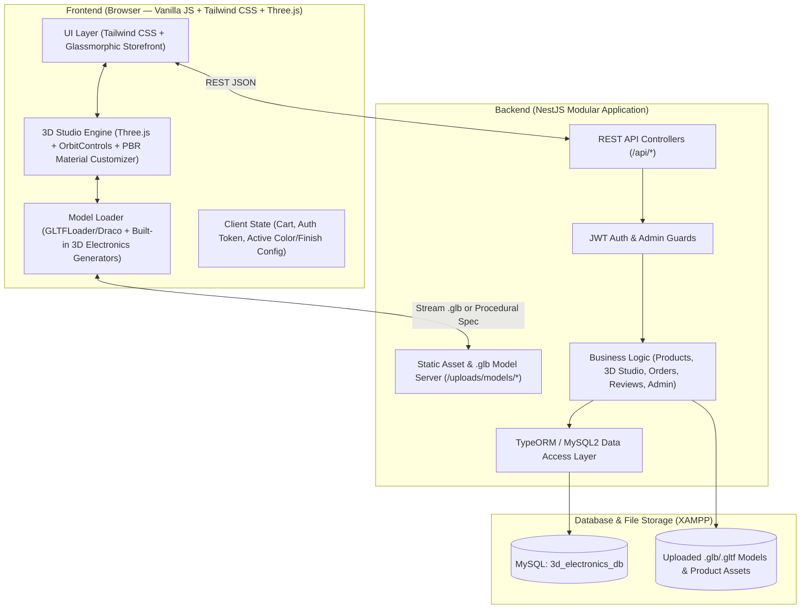

# 3D Interactive Electronics E-Commerce Platform — Final Implementation Plan

> **Tech Stack**: NestJS (Backend API & Static Server) • MySQL (`localhost:3306` via XAMPP) • Tailwind CSS (Styling) • Vanilla JavaScript ES6+ & Three.js / GSAP (Interactive 3D Frontend)

---

## 1. Confirmed Project Decisions

| Area | Confirmed Choice |
| :--- | :--- |
| **3D Product Models** | **Hybrid 3D Engine**: Built-in interactive multi-part 3D models (**Headphones, Smartphone, Smartwatch, Wireless Earbuds, Bluetooth Speaker**) ready out of the box **+** Admin support to upload custom `.glb`/`.gltf` 3D files. |
| **Primary 3D Interactions** | **360° Smooth Orbit/Zoom** + **Real-Time PBR Color & Finish Customizer** (Matte, Metallic, Titanium, Neon) + Studio Lighting Presets & Feature Highlights. |
| **MySQL Configuration** | Default XAMPP MySQL (`host: localhost`, `port: 3306`, `user: root`, `password: ""`, `database: 3d_electronics_db` — auto-created on startup). |
| **Currency & Checkout** | **USD (`$`)** with **Cash on Delivery (COD)** and **Simulated Credit Card / Stripe Checkout** with instant order confirmation & tracking. |

---

## 2. System Architecture



---

## 3. MySQL Database Schema (`3d_electronics_db`)

The NestJS backend will automatically create `3d_electronics_db` if it doesn't exist and synchronize/seed the following tables:

1. **`users`**
   - `id` (PK), `full_name`, `email` (Unique), `password_hash`, `role` (`CUSTOMER` | `ADMIN`), `phone`, `shipping_address` (JSON), `created_at`
2. **`categories`**
   - `id` (PK), `name`, `slug` (Unique), `icon`, `description`, `display_order`
   - *Seeded Categories*: Headphones, Smartphones, Smartwatches, Earbuds, Speakers & Audio
3. **`products`**
   - `id` (PK), `category_id` (FK), `name`, `slug` (Unique), `sku` (Unique), `brand`, `tagline`, `description`, `base_price` (`DECIMAL(10,2)`), `sale_price` (`DECIMAL(10,2)`), `stock_quantity`, `is_featured`, `is_active`, `technical_specs` (JSON), `rating_average`, `review_count`, `created_at`
4. **`product_3d_configs`**
   - `id` (PK), `product_id` (FK), `model_type` (`PROCEDURAL_HEADPHONE` | `PROCEDURAL_PHONE` | `PROCEDURAL_WATCH` | `PROCEDURAL_EARBUDS` | `PROCEDURAL_SPEAKER` | `GLB_FILE`), `glb_file_url`, `default_scale`, `camera_position` (JSON), `default_env_preset` (`studio` | `dark` | `neon` | `warm`), `auto_rotate`, `supports_explode_view`
5. **`product_variants` (Real-Time 3D Color & Finish Presets)**
   - `id` (PK), `product_id` (FK), `variant_name` (e.g., *Obsidian Matte Black*, *Titanium Silver*, *Cyber Neon Cyan*, *Sunset Copper*), `primary_hex`, `secondary_hex`, `accent_hex`, `finish_type` (`MATTE` | `METALLIC` | `GLOSSY` | `NEON`), `metalness` (`FLOAT`), `roughness` (`FLOAT`), `price_modifier` (`DECIMAL(10,2)`), `stock_quantity`
6. **`product_hotspots`**
   - `id` (PK), `product_id` (FK), `title`, `description`, `pos_x`, `pos_y`, `pos_z`, `cam_x`, `cam_y`, `cam_z`
7. **`orders` & `order_items`**
   - `orders`: `id`, `order_number` (Unique, e.g., `ORD-2026-8492`), `user_id` (nullable for guest), `customer_name`, `customer_email`, `customer_phone`, `shipping_address` (JSON), `subtotal`, `shipping_cost`, `tax_amount`, `total_amount`, `payment_method` (`COD` | `STRIPE_CARD`), `payment_status` (`PENDING` | `PAID`), `order_status` (`PENDING` | `PROCESSING` | `SHIPPED` | `DELIVERED` | `CANCELLED`), `created_at`
   - `order_items`: `id`, `order_id` (FK), `product_id` (FK), `variant_id` (FK), `product_name`, `variant_name`, `finish_type`, `color_hex`, `quantity`, `unit_price`
8. **`reviews`**
   - `id` (PK), `product_id` (FK), `user_id` (FK), `reviewer_name`, `rating` (1–5), `comment`, `created_at`

---

## 4. Project File & Folder Structure

```text
d:\xampp\htdocs\3dweb\
├── package.json
├── tsconfig.json
├── nest-cli.json
├── .env                               # MySQL & JWT configuration
├── src/
│   ├── main.ts                        # NestJS bootstrap, CORS, Static asset serving
│   ├── app.module.ts                  # Root module + MySQL auto-database initializer
│   ├── database/
│   │   ├── database.module.ts         # TypeORM connection + schema setup
│   │   ├── entities/                  # User, Category, Product, Product3DConfig, Variant, Hotspot, Order, Review
│   │   └── seed.service.ts            # Auto-seeds 8+ flagship 3D electronics products & Admin account
│   └── modules/
│       ├── auth/                      # Login, Register, JWT Guard, Admin Role Guard
│       ├── products/                  # Catalog, filtering, search, 3D config & variants endpoints
│       ├── studio-3d/                 # Custom .glb upload (Multer), variant & 3D settings update
│       ├── orders/                    # USD Cart checkout (COD & Simulated Stripe Card) + Order Tracker
│       ├── reviews/                   # Customer product reviews
│       └── admin/                     # Admin KPIs, inventory management, order status updates
└── public/                            # Frontend Application (Tailwind CSS + Vanilla JS + Three.js)
    ├── index.html                     # Main Interactive 3D Storefront, Configurator Studio & Admin Portal
    ├── css/
    │   └── custom.css                 # Custom glassmorphism, 3D canvas HUD, animations
    ├── js/
    │   ├── api.js                     # REST API client & auth state manager
    │   ├── three/
    │   │   ├── SceneManager.js        # Three.js WebGLRenderer, OrbitControls, Studio Lighting, Shadows
    │   │   ├── ElectronicsBuilder.js  # High-detail 3D models (Headphones, Phone, Watch, Earbuds, Speaker) + GLTF/GLB Loader
    │   │   └── MaterialCustomizer.js  # Smooth GSAP transitions for Matte, Metallic, Titanium & Neon PBR materials
    │   ├── store/
    │   │   ├── catalog.js             # Category filtering, search, sorting, 3D quick-view cards
    │   │   ├── configurator.js        # Interactive 3D Product Studio (Color swatches, Finish selector, Zoom/Orbit, Specs)
    │   │   └── checkout.js            # Slide-over Cart, USD Checkout (Stripe Card / COD), Order Tracking modal
    │   └── admin/
    │       └── dashboard.js           # Admin CRUD for products, .glb 3D model uploader, variant editor & order management
    └── uploads/
        └── models/                    # Directory for uploaded .glb / .gltf files
```

---

## 5. Step-by-Step Implementation Phases

### Phase 1: Project Initialization & MySQL Database Layer
1. Initialize the NestJS project in `d:\xampp\htdocs\3dweb` with TypeScript, TypeORM, `mysql2`, `@nestjs/serve-static`, `@nestjs/jwt`, `bcryptjs`, and `multer`.
2. Create an automatic MySQL bootstrap check (`CREATE DATABASE IF NOT EXISTS 3d_electronics_db`) so it works seamlessly with XAMPP MySQL on `localhost:3306`.
3. Define all TypeORM entities and build `SeedService` to populate:
   - **Categories**: Headphones, Smartphones, Smartwatches, Wireless Earbuds, Portable Speakers.
   - **Flagship 3D Products** with multiple **Matte, Metallic, and Neon color variants**:
     - *Aether Pro Max ANC Headphones* (`$349.00`)
     - *Nova X1 Ultra 5G Smartphone* (`$999.00`)
     - *Chronos Titan S9 Smartwatch* (`$429.00`)
     - *SonicPods Pro 3 ANC Earbuds* (`$249.00`)
     - *PulseSphere 360 Spatial Speaker* (`$299.00`)
     - *HyperWave Studio Gaming Headset* (`$199.00`)
     - *Vertex Fold Z Quantum Phone* (`$1,299.00`)
     - *AeroFit Ultra GPS Watch* (`$319.00`)
   - Default Admin account (`admin@3dstore.com` / `admin123`) & Demo Customer account.

### Phase 2: NestJS REST APIs & `.glb` Model Upload
1. Build `ProductsController` & `ProductsService` (list with filters, featured products, single product with 3D config, color variants, hotspots, and reviews).
2. Build `OrdersController` & `OrdersService` (create order with COD or simulated Stripe Card validation, calculate USD subtotal/shipping/tax, deduct stock, track order by `orderNumber`).
3. Build `AdminController` & `Studio3DController` (create/edit products, add color/finish variants, upload custom `.glb`/`.gltf` files via Multer, manage orders).

### Phase 3: Interactive 3D Engine (`Three.js` + `GSAP`)
1. Implement `SceneManager.js`:
   - High-DPI `THREE.WebGLRenderer` with ACES Filmic tone mapping, physical lighting, contact shadow plane, and smooth damped `OrbitControls` (360° orbit, zoom in/out, auto-rotate toggle, camera reset).
2. Implement `ElectronicsBuilder.js`:
   - Loads external `.glb`/`.gltf` models when a product has `model_type === 'GLB_FILE'`.
   - Generates multi-mesh, high-detail 3D models for **Headphones, Smartphone, Smartwatch, Earbuds, and Speaker** with distinct material groups (`primaryMesh`, `secondaryMesh`, `accentGlowMesh`, `glassMesh`, `metalTrimMesh`) and interactive component explode/disassemble animation.
3. Implement `MaterialCustomizer.js`:
   - Real-time switching between **Matte** (`roughness: 0.75, metalness: 0.15`), **Metallic/Titanium** (`roughness: 0.2, metalness: 0.9`), **Glossy Ceramic** (`roughness: 0.08, metalness: 0.3`), and **Cyber Neon** (emissive accent glow) with smooth GSAP color tweening.
   - Custom Color Picker + Pre-configured Variant Swatches + Studio Lighting Switcher (Studio Soft, Dark Obsidian, Cyber Neon, Warm Sunset).

### Phase 4: Storefront UI, 3D Configurator & USD Checkout
1. Build the responsive dark-mode + glassmorphic storefront using **Tailwind CSS**:
   - **Interactive 3D Hero Stage**: Live 3D flagship showcase right on the home screen with instant color/finish switcher, device selector tabs, and 360° drag controls.
   - **Smart Electronics Catalog**: Filter by category, search keyword, price range, and sort order.
   - **Full-Screen / Modal 3D Product Studio**: Deep customization of primary/secondary colors, surface finish (Matte, Metallic, Neon), interactive feature hotspots, exploded view slider, technical specifications table, and customer reviews.
   - **Slide-Over Cart & Checkout Modal**: Preserves the exact 3D color & finish configuration chosen by the shopper, supports **Stripe / Credit Card (Simulated)** and **Cash on Delivery (COD)** in **USD (`$`)**, and provides an instant **Order Tracking** lookup.

### Phase 5: Admin Dashboard & 3D Model Manager
1. Build an integrated Admin Portal allowing the store owner to:
   - View store metrics (Total USD Revenue, Orders, Products, Stock Alerts).
   - Add new electronics products or edit existing ones.
   - Upload custom `.glb` / `.gltf` 3D model files or choose a built-in 3D archetype.
   - Configure default 3D colors, finishes, and manage customer order statuses.

### Phase 6: Testing & Verification
1. Verify XAMPP MySQL connectivity, database seeding, API endpoints, 3D WebGL performance, customizer responsiveness, checkout persistence, and Admin `.glb` upload.
